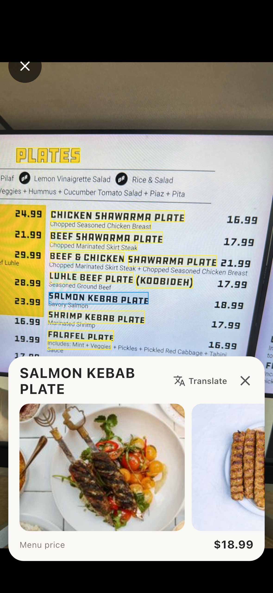
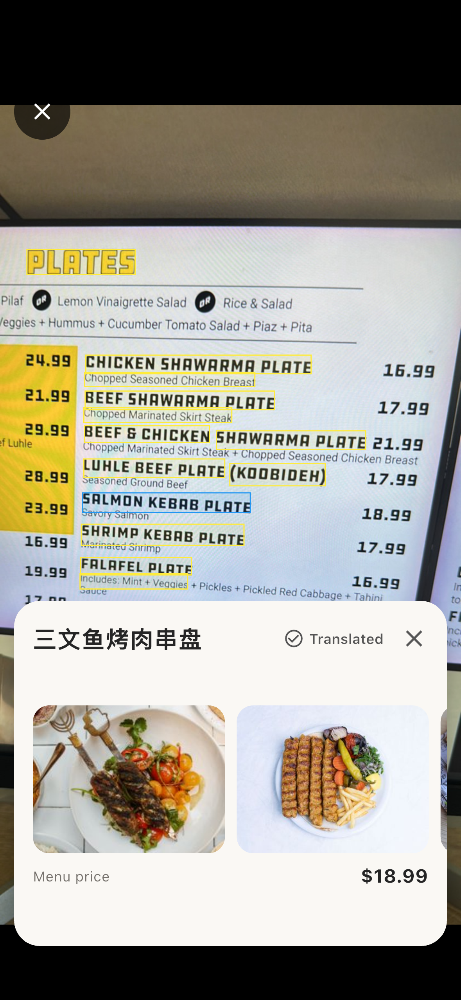
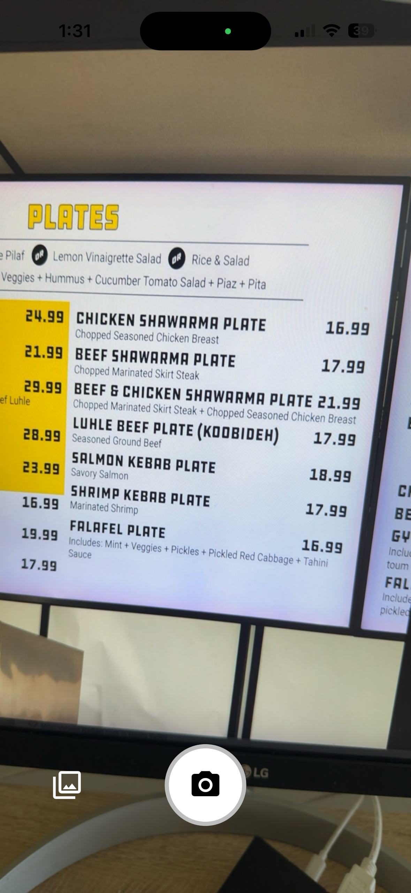
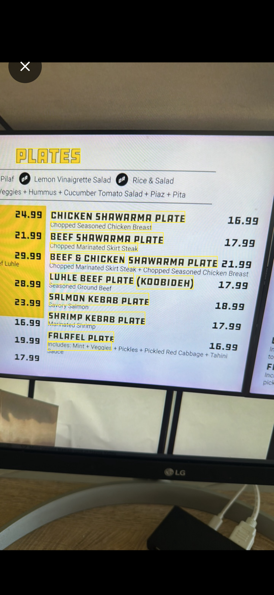
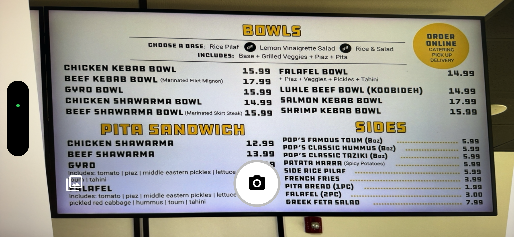
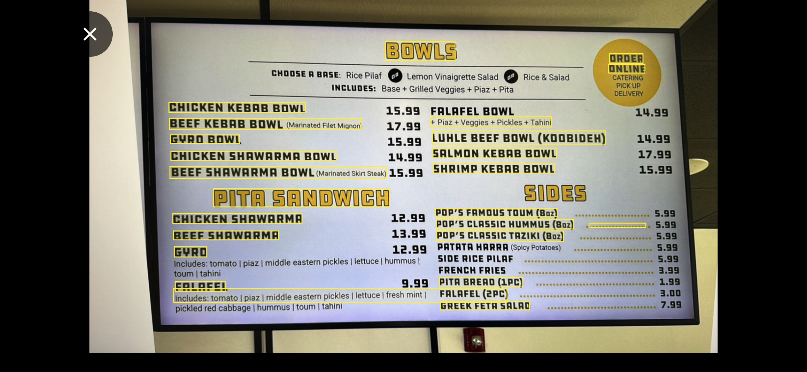
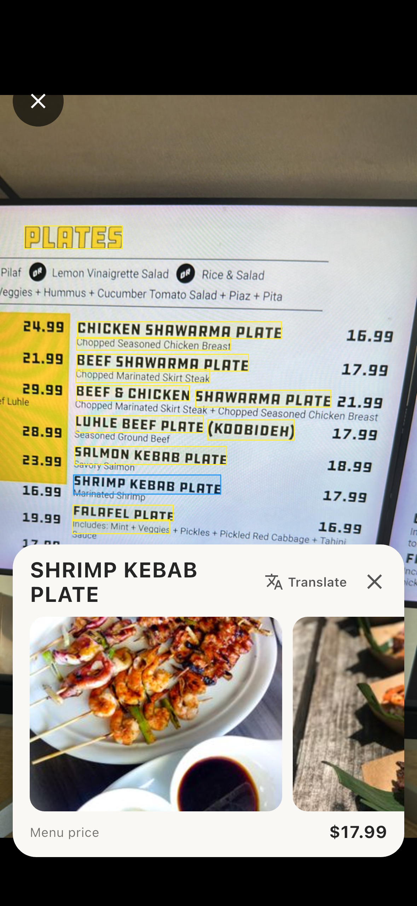
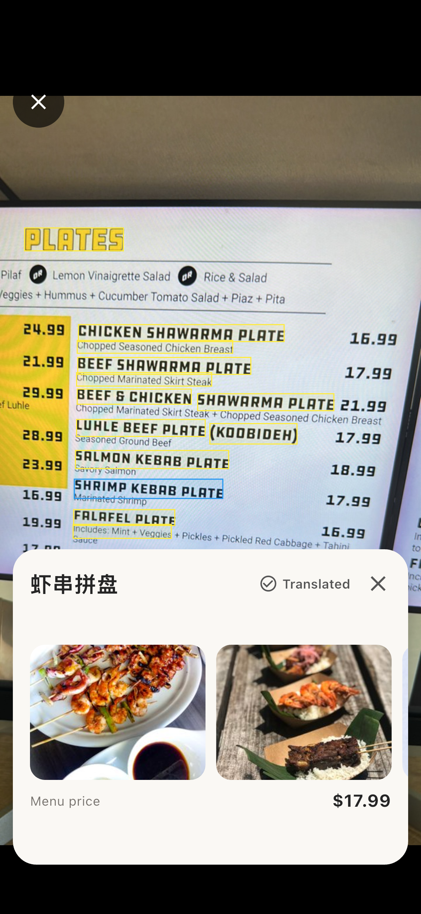

# MenuTranslate

**An interactive restaurant-menu reader built with Flutter, on-device OCR, layout-aware parsing, and on-demand translation.**

MenuTranslate turns a photographed restaurant menu into an interactive interface. Users can tap recognized dish names to view descriptions, detected prices, related food photos, and Simplified Chinese translations—without manually typing the dish name or leaving the original menu image.

> **Status:** Working prototype under active development. Menu understanding uses heuristic parsing; results can vary with OCR quality and menu layout.

## App at a Glance

<p align="center">
  
  &nbsp;&nbsp;
  
</p>
<p align="center"><em>From dish discovery to in-place translation: the original menu remains visible behind the detail card.</em></p>

## Why I Built It

Restaurant menus can be difficult to interpret when dishes are unfamiliar, descriptions are lengthy, or the language is new to the diner. I wanted to explore how mobile computer vision and text-processing techniques could make a physical menu interactive while keeping the menu image as the primary interface.

The central technical challenge is not simply recognizing text. It is determining **which phrases represent dish names, which lines describe them, and which prices belong to which dishes** despite multi-column layouts, inconsistent typography, and OCR errors.

## Feature Walkthrough

### 1. Capture a Menu and Identify Dish Names

Users can photograph a menu or select an existing photo. Google ML Kit extracts text and bounding boxes; the app groups nearby words into phrases and highlights candidate dish names directly on the image.

<table>
  <tr><th align="center">Original menu</th><th align="center">OCR-based dish detection</th></tr>
  <tr>
    <td align="center"></td>
    <td align="center"></td>
  </tr>
  <tr>
    <td><sub>Input image: a restaurant menu with multiple lines of text.</sub></td>
    <td><sub>Processed image: selectable highlights indicate candidate dish names inferred from OCR coordinates.</sub></td>
  </tr>
</table>

### 2. Parse Multi-Column Menus

MenuTranslate uses bounding-box geometry to group phrases, estimate column boundaries, identify possible dish headings, and associate nearby descriptions and prices. A subsequent matching pass can attempt to recover prices missed during the initial parse.

<table>
  <tr><th align="center">Multi-column input</th><th align="center">Detected dish regions</th></tr>
  <tr>
    <td align="center"></td>
    <td align="center"></td>
  </tr>
  <tr>
    <td><sub>Layout challenge: separate menu sections and prices appear across the page.</sub></td>
    <td><sub>Parsing output: geometric heuristics identify candidate dishes while preserving their positions.</sub></td>
  </tr>
</table>

This is an interpretable heuristic pipeline, not a trained menu-specific classifier. Overlapping columns, wine-pairing lines, and fragmented OCR text can still cause false positives or missing prices.

### 3. Explore a Dish Without Leaving the Menu

Tapping a highlighted dish opens a fixed bottom card. It displays the selected dish name, its extracted description and price when available, and related photos retrieved through Pexels. The original menu remains visible behind the card.

<table>
  <tr><th align="center">Dish example A</th><th align="center">Dish example B</th></tr>
  <tr>
    <td align="center"></td>
    <td align="center"></td>
  </tr>
  <tr>
    <td><sub>Dish selection opens a photo gallery and structured details.</sub></td>
    <td><sub>The reusable card supports different dishes and varying descriptions.</sub></td>
  </tr>
</table>

_Food photos are search results and are not verified photographs of the restaurant's own dishes._

### 4. Translate Dish Names and Descriptions In Place

The Translate action requests a Simplified Chinese translation for the selected dish. The translated name **replaces the English card heading**, and the translated description replaces the English description; the menu image and food photos remain unchanged.

<table>
  <tr><th align="center">Before: English</th><th align="center">After: Chinese</th></tr>
  <tr>
    <td align="center"></td>
    <td align="center"></td>
  </tr>
  <tr>
    <td><sub>Original dish name and description.</sub></td>
    <td><sub>Translated text appears in the same locations, without an additional panel.</sub></td>
  </tr>
  <tr>
    <td align="center"></td>
    <td align="center"></td>
  </tr>
  <tr>
    <td><sub>A second dish before translation.</sub></td>
    <td><sub>The same in-place translation behavior on another dish.</sub></td>
  </tr>
</table>

> Translation requires a configured translation service. Production deployments should keep credentials on a secured backend rather than inside the Flutter application.

## Processing Pipeline

```text
Camera / Photo Library
         |
         v
     Menu Image
         |
         v
  Google ML Kit OCR
 (text + bounding boxes)
         |
         v
    Phrase Grouping
         |
         v
    Column Detection
         |
         v
 Menu Structure Parsing
 (dish / price / description)
         |
         v
 Interactive OCR Overlay
         |
         v
       User Tap
       /      \
      v        v
 Pexels Image  Translation
    Search       Service
       \        /
        v      v
     Dish Detail Card
```

**OCR and spatial grouping.** Text elements retain their bounding boxes so the app can reason about rows, relative spacing, and reading order instead of treating the menu as a single block of text.

**Menu structure inference.** The parser evaluates candidate headings, detects possible column boundaries, and associates descriptions and prices using text and geometry heuristics.

**Interactive presentation.** Detected dish regions are mapped back onto the source image. Taps select the corresponding structured item and trigger image retrieval; translation is requested only when the user asks for it.

## Key Features

- **Camera and photo import:** Capture a restaurant menu or choose an existing image.
- **On-device OCR:** Recognize text and bounding boxes with Google ML Kit.
- **Layout-aware parsing:** Group phrases, detect columns, and infer dish names, descriptions, and prices.
- **Interactive highlighting:** Select dish-name regions directly on the menu image.
- **Dish photo discovery:** Display related Pexels search results in a horizontal gallery.
- **On-demand translation:** Replace the selected card's name and description with Simplified Chinese text.

## Technical Stack

| Area                 | Technology / Approach                                                          |
| -------------------- | ------------------------------------------------------------------------------ |
| Mobile application   | Flutter, Dart                                                                  |
| Text recognition     | Google ML Kit OCR                                                              |
| Text layout analysis | Bounding-box geometry and phrase grouping                                      |
| Menu understanding   | Heuristic column detection, heading identification, price/description matching |
| Image retrieval      | Pexels API                                                                     |
| Translation          | On-demand translation service                                                  |
| Development          | Flutter tooling, Git, GitHub                                                   |

## Code Organization

```text
lib/
├── core/
│   └── services/
│       ├── menu_phrase_service.dart         # Group OCR words into phrases
│       ├── menu_column_service.dart         # Detect menu columns
│       └── menu_structure_service.dart      # Parse dishes, prices, descriptions
└── features/
    └── menu_scanner/
        ├── screens/
        │   ├── home_page.dart               # State and feature orchestration
        │   ├── camera_mode.dart             # Camera interface
        │   └── menu_mode.dart               # Menu overlay and dish card
        └── painters/
            └── menu_highlight_painter.dart  # OCR highlights
```

## Engineering Challenges and Lessons

**Recovering structure from OCR.** OCR provides text and locations, but not a reliable menu hierarchy. I worked with bounding-box relationships to handle multiline headings, nearby prices, and multi-column layouts.

**Handling imperfect input.** Decorative headings, ingredient lines, and pairing suggestions may resemble dish names. The parser uses multiple heuristics, but it still needs evaluation across more menu styles.

**Managing asynchronous interactions.** Image searches and translations are triggered after a selection, requiring loading indicators and careful handling of results when the user changes dishes.

**Designing for constrained screen space.** A fixed-height bottom card keeps the source menu visible while presenting images, prices, descriptions, and translations. Scrollable text accommodates longer content.

## Current Limitations

- Dish extraction may misclassify section headings, ingredients, or pairing recommendations.
- Price matching can fail on unusual or overlapping layouts.
- OCR depends on image sharpness, lighting, text size, and typography.
- Pexels photos are illustrative search results, not restaurant-verified dish photos.
- Translation can be imperfect for culinary terms or OCR mistakes.

## Next Steps

- Build a labeled menu dataset to measure dish-detection precision/recall and price-matching accuracy.
- Improve segmentation for overlapping columns and multiline headings.
- Add automated tests for repeated prices, pairing lines, and OCR edge cases.
- Support selectable translation languages and translation caching.
- Improve accessibility, network error handling, and device testing.

## Running the Project

Install the Flutter SDK and configure any external services required by the image-search and translation features.

```bash
flutter pub get
flutter analyze
flutter run
```

Do not commit API keys, service-account files, or other credentials to the repository.

## About This Project

I developed MenuTranslate as a hands-on software engineering project while expanding my computer science background. It combines mobile application development, geometric reasoning over OCR results, heuristic parsing, API integration, and iterative debugging with real-world menu images.

The project reflects my interest in building practical systems that connect algorithmic problem-solving with usable interfaces.
